# 미리 채움 · 관심 주행 · 안심 이웃 — Pleos Connect 차량용 앱

현대자동차그룹 차량용 앱 개발 공모전 출품작 저장소입니다. 앱 세 개가 공통 모듈을 함께 씁니다.

| 앱 이름 | 한 줄 소개 |
|---|---|
| **미리 채움** | 요일·시간마다 반복해서 가는 목적지와 캘린더에 등록한 일정의 목적지를 파악해, 그 일정 전에 다녀오는 데 필요한 최소·권장 충전량과 충전(주유)에 걸리는 시간을 미리 알려주는 앱. 모자라면 어차피 머무는 곳처럼 채울 곳까지 제안합니다 |
| **관심 주행** | 앞으로 지날 2km의 도로 상황과 지금 날씨·시간을 합쳐 위험도를 초록·노랑·빨강으로 보여주고, 빨강으로 바뀔 때만 한 번 말해 주는 앱 |
| **안심 이웃** (시연판) | 등급 공유에 동의한 주변 차량을 8칸 그림으로 보여주고, 주의 차량이 가깝거나 차선을 바꾸려 할 때 거리를 두도록 알려주는 앱. 주변 차량과 등급은 가상 데이터이며 실제 데이터는 내비 회사 협력 후 연결합니다 |

## APK 위치

| 앱 | 파일 |
|---|---|
| 미리 채움 | [`apk/여승훈_미리채움_release.apk`](apk/) |
| 관심 주행 | [`apk/여승훈_관심주행_release.apk`](apk/) |
| 안심 이웃 | [`apk/여승훈_안심이웃_release.apk`](apk/) |

세 파일 모두 실행 가능한 release 빌드이며, Pleos Connect v2.1.0 에뮬레이터에서 설치·실행을 확인했습니다.

## 시연 영상

에뮬레이터 화면을 장면별로 보여 주며 각 기능과 사용한 Pleos SDK를 한국어 음성으로 설명하는 영상입니다(YouTube 일부 공개).

| 앱 | 영상 | 길이 |
|---|---|---|
| 미리 채움 | https://youtu.be/5jDYIv-D8Q4 | 4분 41초 |
| 관심 주행 | https://youtu.be/cNmCtE_qzS8 | 2분 20초 |
| 안심 이웃 (시연판) | https://youtu.be/_66NkVfOo78 | 1분 49초 |

## 화면

Pleos Connect v2.1.0 에뮬레이터(2560×1440)에서 release APK를 시연 모드로 실행해 앱 창만 잘라낸 화면입니다.

### 미리 채움

| 홈: 다음 일정(토요일 양평) 전 최소 52%·권장 63%, 급속·완속 시간 | 캘린더: 반복 목적지 양평의 출발 전 최소·권장 |
|---|---|
| 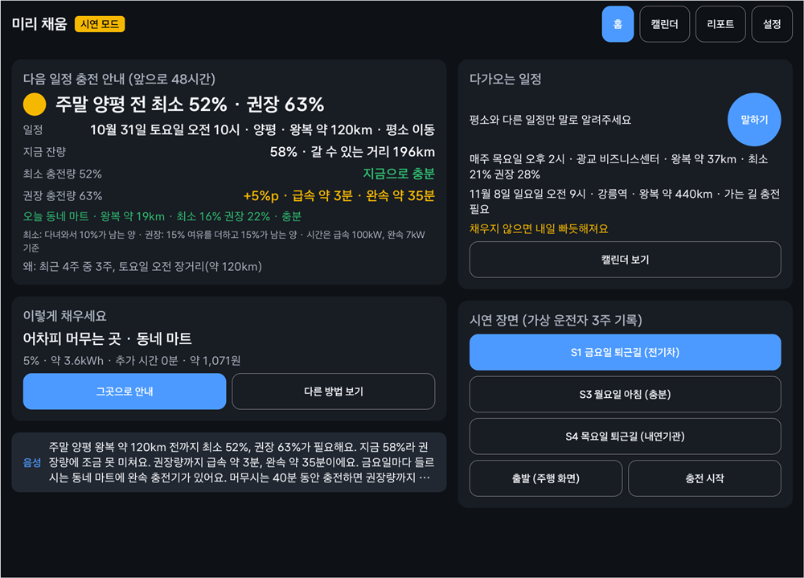 | 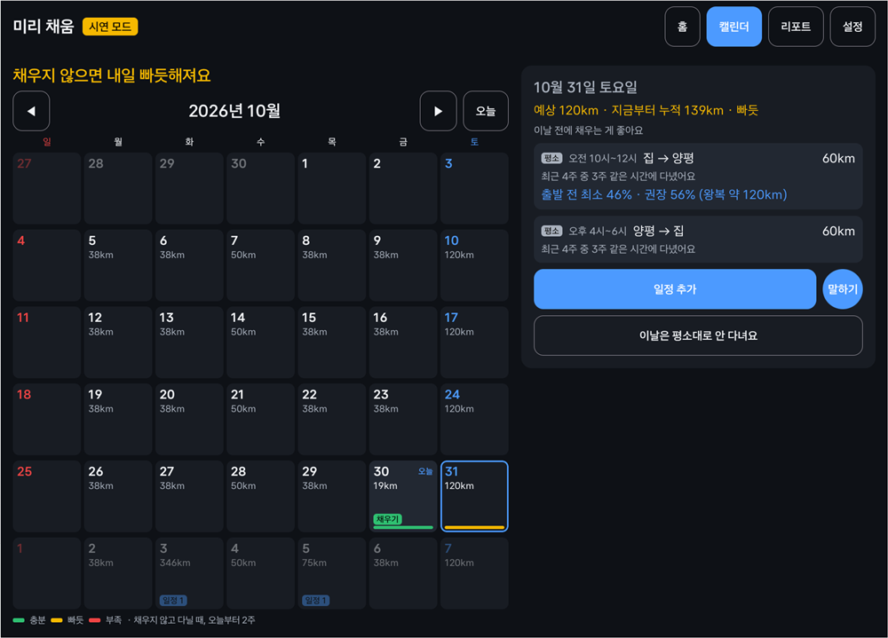 |
| **말로 일정 등록: 한 번 충전으로 모자라면 가는 길 충전 안내** | **주행 중 한 줄** |
| 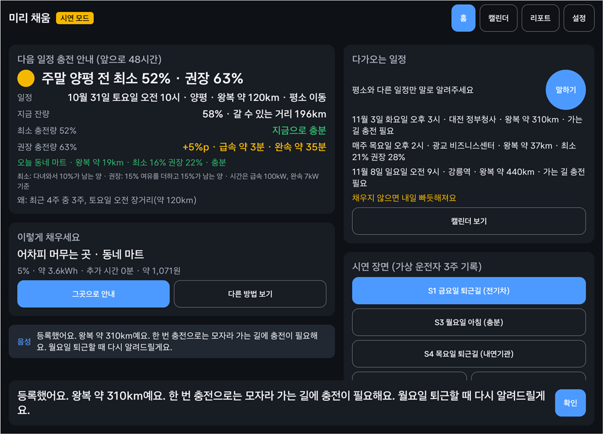 | 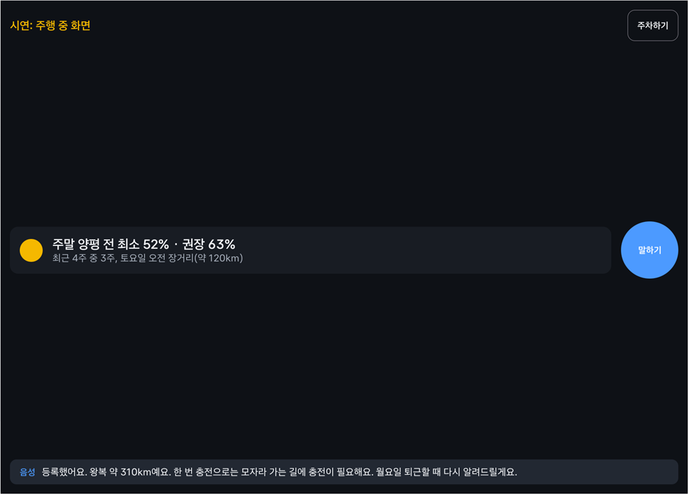 |
| **충전 중 권장량까지 남은 시간** | **터치로 일정 추가: 출발할 때 최소 55%·권장 67%** |
| 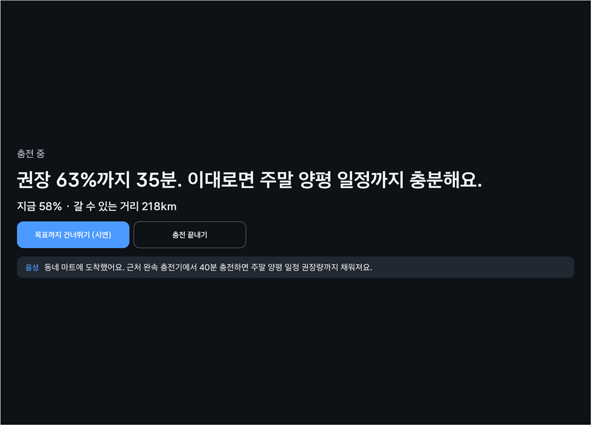 | 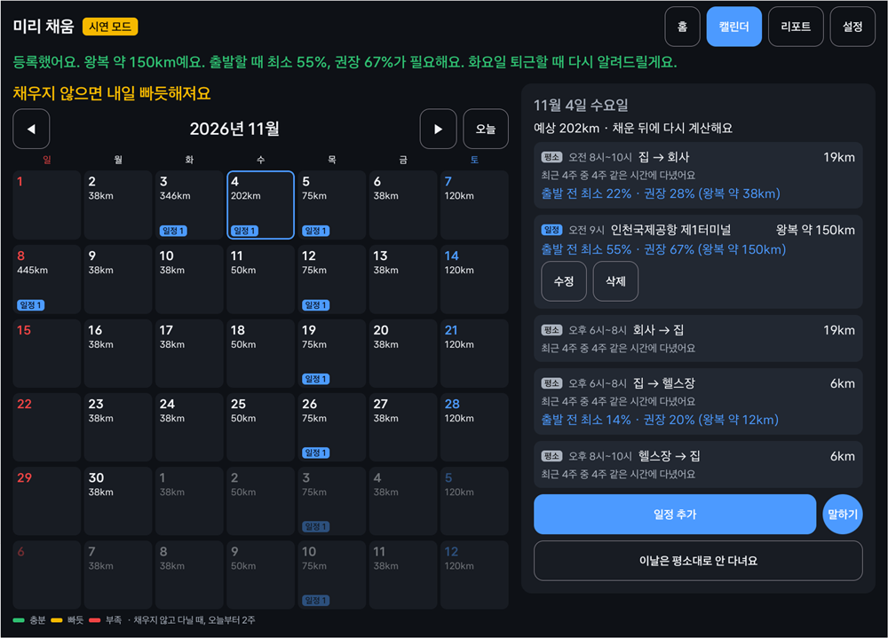 |

### 관심 주행

| 초록: 주의할 구간 없음 | 노랑: 안개 구간 |
|---|---|
| 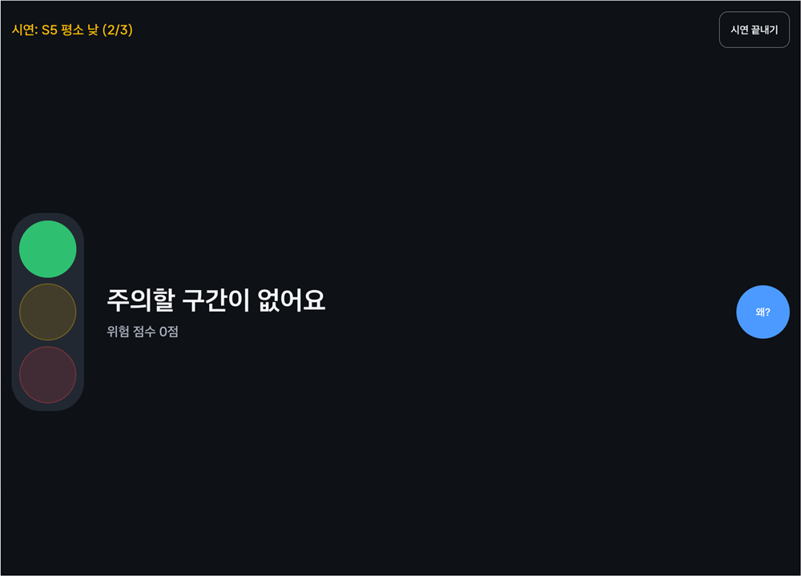 | 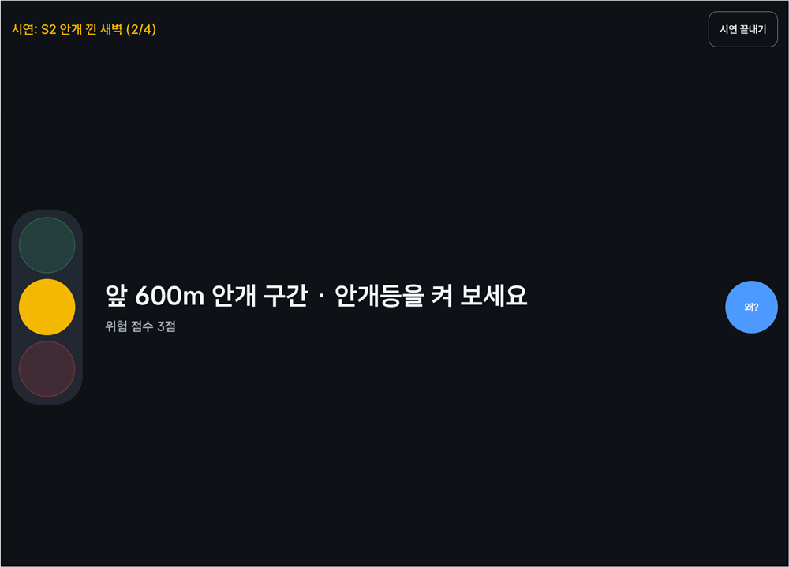 |
| **빨강: 비 오는 밤 사고 잦은 내리막 (음성 1회)** | **주차 후 오늘 요약·설정** |
| 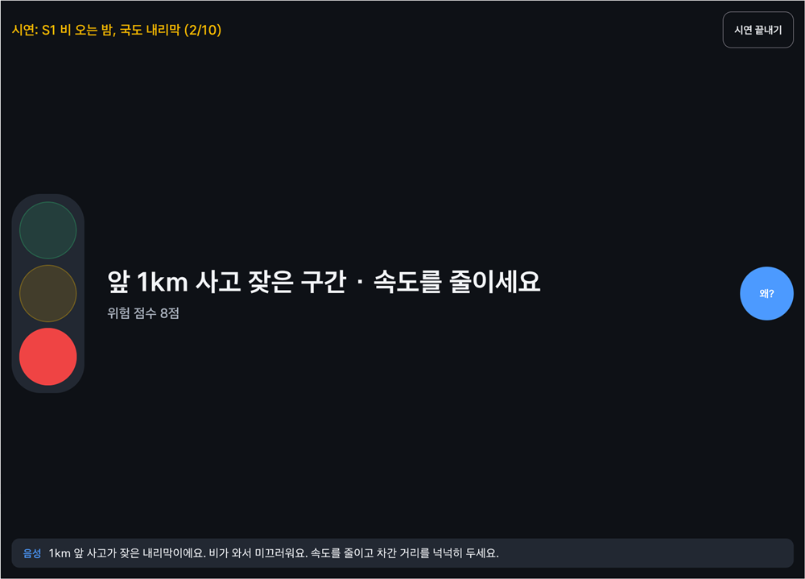 | 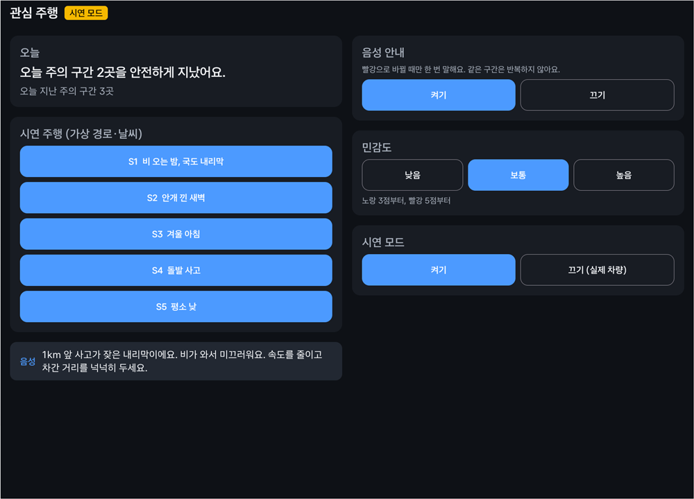 |

### 안심 이웃 (시연판, 가상 데이터)

| 위치 제공·등급 공유 동의 | 주의 차량 접근 안내 |
|---|---|
| 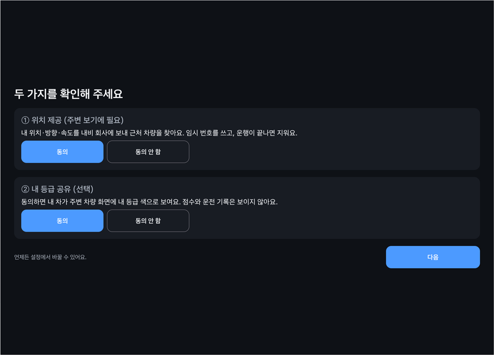 | 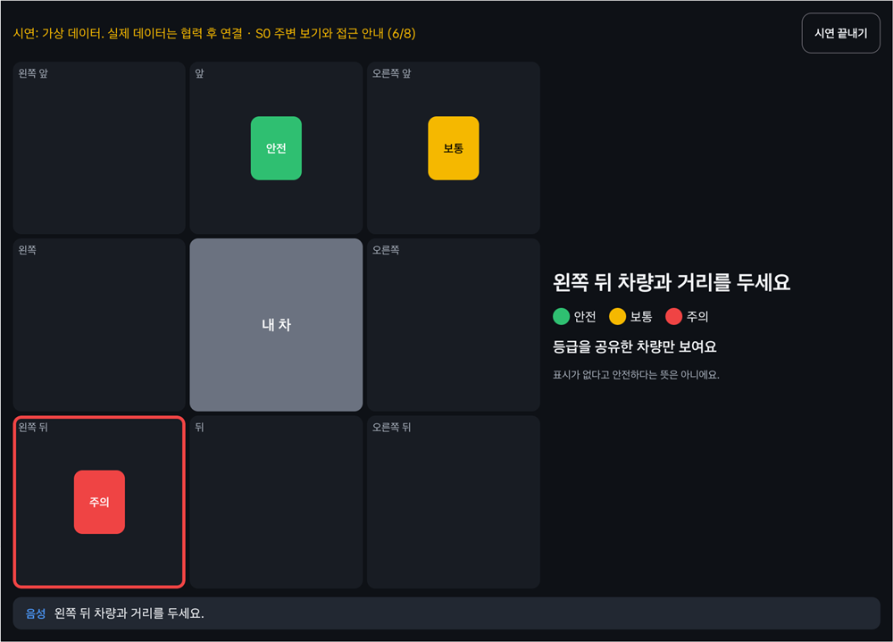 |
| **차선 변경 직전 안내** | **내 등급** |
| 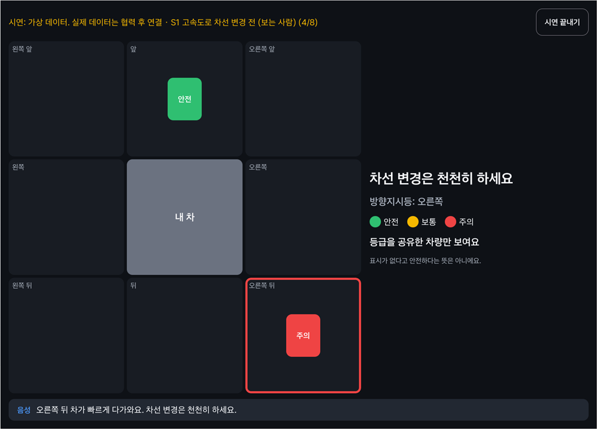 | 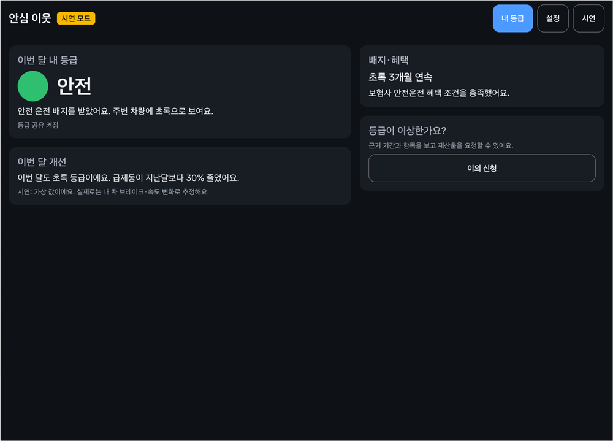 |

## 실행 방법

1. Pleos Connect 에뮬레이터(Android 14, Automotive)를 켭니다.
2. APK를 설치합니다: `adb install -r -g apk/여승훈_미리채움_release.apk` (`-g`는 속도·마이크 권한을 미리 허용)
3. 앱 목록에서 실행합니다. 처음에는 **시연 모드**로 켜집니다.
   - **미리 채움:** 하루 주행 거리를 고르면 홈에 다음 일정(토요일 양평)의 최소·권장 충전량과 급속·완속 시간이 나오고 S1 음성 안내가 이어지며, 이어서 '응/아니' 버튼으로 대답할 수 있습니다. 오른쪽 '시연 장면'에서 S1·S3·S4를 고릅니다. '출발' 뒤 '주차하기'를 누르면 체류 장소 도착 안내가, '충전 시작'을 누르면 충전 목표 화면이 나옵니다. 마이크 버튼을 누르면 예문 버튼으로 음성 일정 등록을 해볼 수 있습니다('내일 대전 출장'은 시각을 되묻고, '매주 목요일 …'은 매주 일정이 됩니다). '캘린더' 탭에서는 날짜별 일정·평소 이동·지난 기록과 2주 전망을 보고, '일정 추가'로 터치 등록·수정을, '이날은 평소대로 안 다녀요'로 그날 평소 이동 빼기를 해볼 수 있습니다. 장면을 고르면 시연 일정은 처음 상태로 돌아갑니다.
   - **관심 주행:** 안내를 확인한 뒤 '시연 주행' S1~S5를 누르면 가상 경로를 4배속으로 달립니다.
   - **안심 이웃:** 안내와 동의를 지나 '시연' 탭에서 장면을 고릅니다. S1에서는 오른쪽 방향지시등을 켠 장면에서 안내가 나옵니다.
4. 실제 차량 값으로 보려면 설정에서 시연 모드를 끕니다(안심 이웃은 협력 전이라 주변 차량을 받지 못한다는 안내만 나옵니다).

## 테스트 환경

| 항목 | 값 |
|---|---|
| 에뮬레이터 | Pleos Connect v2.1.0 (system-images;android-34;pleos_car_emulator;x86_64), 2560×1440 |
| 최소 버전 | Android 9 (API 28) |
| 빌드 | JDK 21, Gradle 8.10.2, Android Gradle Plugin 8.7.3, Kotlin 2.1.0, Jetpack Compose |
| Pleos SDK | Vehicle 2.3.2, NaviHelper 3.0.5, TextToSpeech 3.3.1, SpeechToText 3.3.1, FusedLocation 1.1.3 |

### 에뮬레이터에서 확인한 범위

- **시연 모드:** 세 앱의 시나리오 전체.
- **실제 SDK로 확인:** TTS 음성, 주행가능거리 읽기, 위치, NaviHelper 경로 거리·도착 시 예상 배터리(`requestTrip`), 경로 안내 시작(`requestRoute`), 경유지 추가(`addWaypoint`), 경로 혼잡 정보.
- **아직 확인하지 못한 것:** 기어·와이퍼 변화(에뮬레이터 차량 값을 바꾸지 못함), 주행 중 주의 지점 이벤트(에뮬레이터에서 차가 움직이지 않음), 실제 음성 인식 품질. 이 부분은 판단 규칙의 자동 테스트와 시연 모드로 검증합니다.

## 필요 설정

- 권한: 차량 속도(`android.car.permission.CAR_SPEED`, 시스템 창에는 '위치 정보'로 표시됨), 마이크(`RECORD_AUDIO`). 설치할 때 `-g`를 주거나 첫 실행 때 허용합니다. 거부해도 앱은 동작하며 필요한 곳에서 안내합니다.
- 별도 계정·API 키 없이 동작합니다. 제출 APK의 장소 검색·충전소·주유소는 시연용 목록입니다.
- 실제 데이터로 시험하려면 `local.properties`에 `KAKAO_REST_KEY`, `DATA_GO_KR_KEY`, `OPINET_KEY`를 넣고 debug 빌드를 만듭니다. release에는 키가 들어가지 않습니다.

## 핵심 기능과 Pleos SDK

### 미리 채움

| 핵심 기능 | SDK / API | 무엇을 하는가 |
|---|---|---|
| 반복 목적지 찾기 | Vehicle(Odometer, EvBattery, Fuel), FusedLocation, 표준 차량 속성(GEAR_SELECTION, 외기 온도) | 운행 기록(300m 칸)에서 최근 4주 중 3주 이상 같은 요일·시간대에 간 목적지를 찾고, 가는·돌아오는 이동을 묶어 왕복으로 셈 |
| 캘린더 일정의 목적지 | 엔진 `EnergyCalendar`, NaviHelper `requestTrip` → `onTripInfo`, SpeechToText + 한국어 일정 해석기(자체) + TextToSpeech(확인) | 앱 안 캘린더에 터치 또는 말("다음 주 화요일 오후 3시에 대전 출장 있어", "매주 …")로 등록한 일정의 장소까지 왕복 거리 |
| 일정별 최소·권장 충전량과 시간 | 엔진 `TripGuidePlanner` (Vehicle의 주행가능거리·잔량·용량, 외기 온도) | 최소 = 다녀온 뒤 10%(내연기관 30km) 남는 양, 권장 = 15% 여유 + 15%(50km) 남는 양. 지금 잔량에서 급속 100kW·완속 7kW(내연기관은 L·약 5분)로 걸리는 시간 |
| 판정 안내와 대답 | TextToSpeech + SpeechToText | 권장 미만(노랑)·최소 미만(빨강)일 때 운행 시작에 1회 "주말 양평 전까지 최소 52%, 권장 63%…" 안내, "응" 듣기 |
| 해결책 실행 | NaviHelper `requestRoute`, `addWaypoint` | "응" 하면 충전소를 목적지 또는 경유지로 |
| 주행·주차·충전 구분 | 표준 차량 속성(속도, 주차 브레이크, 충전 상태), CarUxRestrictions | 주행 중에는 한 줄 + 마이크만 |

### 관심 주행

| 핵심 기능 | SDK / API | 무엇을 하는가 |
|---|---|---|
| 앞길 주의 지점 | NaviHelper `onCautionPointInfo` | 사고 다발·안개·미끄러운 도로 등과 남은 거리 |
| 돌발·정체 | NaviHelper `RouteStateInfo.trafficStatus` | 사고·재난·공사, 갑자기 막히는 구간 |
| 비·안개·와셔액 | Vehicle(Wiper, Light, Safety) | 와이퍼, 안개등, 와셔액 부족 |
| 기온·야간 | 표준 차량 속성(외기 온도), 위치로 일몰 계산 | 결빙, 야간 |
| 빨강 전환 안내 · "왜?" | TextToSpeech, SpeechToText | 빨강으로 바뀔 때 1회, 직후 5초 또는 버튼으로 "왜?"에 답함 |

### 안심 이웃 (시연판)

| 핵심 기능 | SDK / API | 무엇을 하는가 |
|---|---|---|
| 차선 변경 직전 안내 | Vehicle(TurnSignal) | 내 방향지시등 쪽의 주의 차량을 먼저 알림 |
| 음성 안내 | TextToSpeech | 가까울 때만 차량마다 1회, 전체 2분에 1회 |
| 주행 상황 구분 | 표준 차량 속성, CarUxRestrictions | 주행 중 터치 요소 없음 |
| 주변 차량·등급 | 가상 데이터 (실제는 내비 회사 API, 협력 후) | 8칸 표시, 3등급 |

## 구조

```
core/common        위치·시간·한국어 문구·일정 해석 (순수 Kotlin)
engine/mirichaeum  미리 채움 판단 규칙 (순수 Kotlin, 테스트 포함)
engine/ansim       관심 주행 판단 규칙 (순수 Kotlin, 테스트 포함)
engine/neighbor    안심 이웃 판단 규칙 (순수 Kotlin, 테스트 포함)
platform/pleos     Pleos SDK 연결 + 시연용 가짜 차량
core/ui            차량 화면 공통 부품
app/mirichaeum     미리 채움 앱
app/ansim          관심 주행 앱
app/neighbor       안심 이웃 시연판
```

판단 규칙은 차 없이 PC에서 검증합니다: `./gradlew test`

## 개인정보

- 미리 채움: 위치는 약 300m 칸으로만 저장하고, 기록은 차 안에만 둡니다. 설정에서 끄거나 지울 수 있습니다. 장소·충전소 검색에는 검색어와 검색에 필요한 좌표만 보냅니다.
- 관심 주행: 지나간 구간의 위치를 저장하지 않습니다. 운행이 끝나면 주의 구간 개수만 남깁니다.
- 안심 이웃: 시연판은 어떤 값도 차 밖으로 보내지 않습니다. 실제 서비스는 동의한 운전자의 3등급과 임시 번호만 다룹니다.
